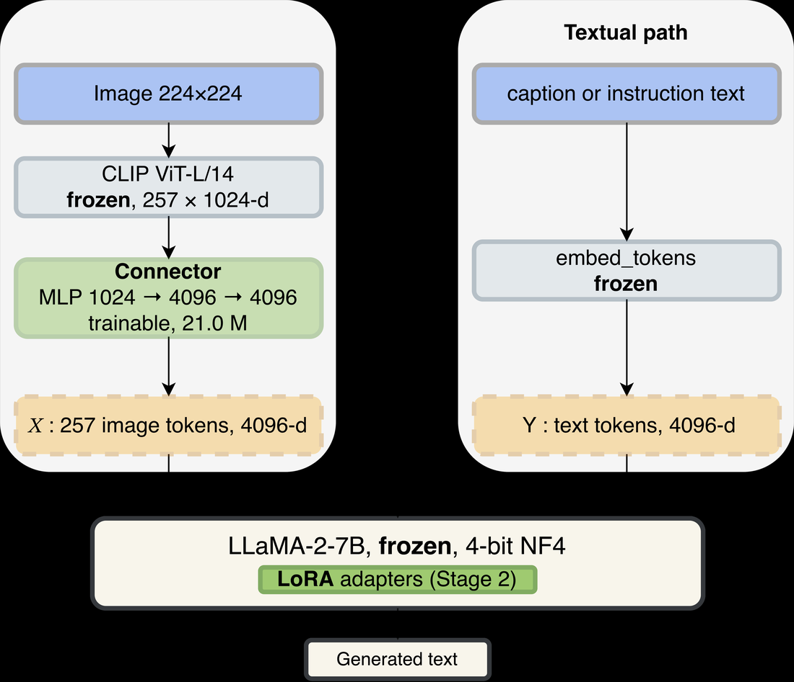

# Modality Gap Properties in Multimodal LLMs for Image Captioning

> Master's thesis · Politecnico di Torino, Data Science and Engineering, a.y. 2025–2026
> Hassine El Ghazel · supervisors prof. Giuseppe Rizzo, Dr. Federico D'Asaro, Dr. Luca Catalano

---

## Summary

Contrastive models such as CLIP show a *modality gap*: image and text embeddings occupy separate
regions of their shared space. The gap also appears in connector-based multimodal large language
models, between the projected image tokens and the text-token embeddings in the language model's
input space, and it persists in fully trained released models such as LLaVA-1.5.

Existing corrections change several properties of the gap at once and evaluate the combined effect,
so they cannot show which property matters. This work decomposes the gap into **four properties**
(centroid distance, total variance, effective rank and subspace alignment) and drives each with a
training loss while **holding the other three fixed**. For image captioning, only closing the
centroid distance improves every measure over a model with all four properties held fixed: captions
match their images better and name more of the objects present while hallucinating fewer.
Compressing the variance hurts, changing the effective rank has no clear effect, and aligning the
subspaces helps only a little. The loss acts during training only, so the deployed model is
unchanged.

---

## Architecture

A frozen CLIP ViT-L/14 encoder, a trainable two-layer MLP connector, and a frozen LLaMA-2-7B (4-bit)
with LoRA adapters. The connector is the only trainable link between the modalities, so every change
to the geometry of the visual representation passes through it. The gap is measured where the
decoder reads its input: between `X`, the 257 projected image tokens, and `Y`, the text tokens, both
in the 4096-d embedding space.

<p align="center">
  
</p>

## Training

Two stages. **Stage 1** trains only the connector with a symmetric InfoNCE loss between the
`[CLS]` token and the mean-pooled caption embedding (Bunny-v1.1). **Stage 2** trains the connector
and the LoRA adapters with an autoregressive loss on response tokens only (LLaVA-Instruct-150K).
Standard training (Stage 1 then Stage 2, no geometry term) is the **baseline**. The geometry losses
below are added in Stage 2.

<p align="center">
  
</p>

---

## The four properties

Measured on the mean of the 257 projected tokens of each image (cloud `X`) and the mean of the
caption's token embeddings (cloud `Y`):

| property | measure | what it captures |
|:---|:---|:---|
| location | $G_\mu = \lVert \bar x - \bar y \rVert$ | distance between the two cloud centres |
| scale | $s = \mathrm{tr}\,\Sigma_X$ | total variance of the image cloud |
| shape | effective rank $r = (\mathrm{tr}\,\Sigma_X)^2 / \mathrm{tr}(\Sigma_X^2)$ | how many directions the variance uses |
| orientation | $O_{16}$, overlap of the top-16 subspaces | alignment of the main directions |

Each property can be **driven** to a new target or **constrained** at its post-Stage-1 value. The
**control** constrains all four. Every other condition drives exactly one property and constrains
the other three.

<p align="center">
  
</p>

The location drive pulls the batch mean of the pooled image vectors towards the text centroid:

$$\mathcal{L}_{\mathrm{dist}} = \frac{\lVert \bar z - \mu_y \rVert^2}{s_X}, \qquad
\bar z = \frac{1}{BT}\sum_{b=1}^{B}\sum_{t=1}^{T} u_{b,t}$$

Every token receives the same gradient, so the image cloud moves as a whole.

<p align="center">
  
</p>

The adopted method, **Cloc**, is

$$\mathcal{L} = 0.9\,\mathcal{L}_{\mathrm{AR}} + 0.1\,\mathcal{L}_{\mathrm{dist}} + 1.0\,\mathcal{L}_{\mathrm{scale}} + 1.0\,\mathcal{L}_{\mathrm{rank}}.$$

---

## Results

### Main result

| | CLIPScore ↑ | SPICE ↑ | METEOR ↑ | CLIPScore ↑ | CHAIR<sub>s</sub> ↓ | CHAIR<sub>i</sub> ↓ | recall ↑ |
|:---|---:|---:|---:|---:|---:|---:|---:|
| | *brief* | *brief* | *brief* | *dd256* | *dd256* | *dd256* | *dd256* |
| baseline | 0.5433 | 0.0908 | 0.1595 | 0.5200 | 0.8269 | 0.4966 | 0.4484 |
| control | 0.5799 | 0.1003 | 0.1525 | 0.5703 | 0.7885 | 0.4396 | 0.4529 |
| **Cloc** | 0.6325 | 0.1212 | 0.1714 | 0.6187 | 0.7369 | 0.3698 | 0.5116 |
| Clocorient ¹ | 0.6421 | 0.1279 | 0.1733 | 0.6312 | 0.7638 | 0.3656 | 0.5336 |

Brief captioning: MSCOCO `val2017`, 5,000 images. Detailed description (`dd256`): first 1,300
images. Cloc improves on the control by +0.0526 [0.049, 0.056] CLIPScore on brief captions and on
the baseline by +0.099 [0.091, 0.106] on detailed descriptions (95 % paired bootstrap intervals over
images). On brief captions, CHAIR<sub>i</sub> falls from the baseline's 0.4811 to 0.3490.

¹ Clocorient drives location and orientation together, so its extra gain cannot be attributed to
either property.

### One property at a time

Geometry each condition reached (n = 5,000; bold = driven property):

| condition | property driven | $G_\mu$ | $\mathrm{tr}\,\Sigma_X$ | $r$ | $O_{16}$ |
|:---|:---|---:|---:|---:|---:|
| control | none | 177.86 | 4252.7 | 36.99 | 0.0515 |
| Cloc | location | **30.97** | 4789.6 | 37.32 | 0.0519 |
| Cscale1500 | scale | 177.74 | **1487.6** | 38.67 | 0.0435 |
| Crank15 | shape | 177.81 | 4311.6 | **20.21** | 0.0517 |
| Corient | orientation | 177.61 | 4578.8 | 35.95 | **0.1114** |

Brief-set CLIPScore difference from the control:

| condition | Δ CLIPScore [95 % CI] | reading |
|:---|:---|:---|
| Cloc | +0.0526 [+0.049, +0.056] | location has the largest effect |
| Cscale1500 | −0.0333 [−0.037, −0.030] | compressing the scale hurts every measure |
| Crank15 | −0.0030 [−0.005, −0.001] | no clear effect (not significant after correction for multiple comparisons) |
| Corient | +0.0151 [+0.013, +0.018] | small, and smaller with a second seed |

Scale and shape change the geometry as much as location does, yet one hurts and the other changes
almost nothing. The location gain is therefore not a generic effect of changing the decoder's input.

### Robustness

<p align="center">
  
</p>

- **Out of distribution.** On 300 NoCaps images (Open Images, disjoint from training) the pattern
  holds: Cloc +0.0668 [0.053, 0.081] over the control.
- **A second judge.** Re-scoring all captions with SigLIP keeps the same order of the four
  single-property conditions on both test sets.
- **A second seed.** Each condition is retrained with seed 1337 (data order and adapter
  initialisation change; the Stage-1 connector is shared). Brief-set difference from the control
  trained with the same seed:

| condition | CLIPScore (42 / 1337) | SPICE (42 / 1337) | METEOR (42 / 1337) |
|:---|:---|:---|:---|
| control (absolute) | 0.580 / 0.582 | 0.100 / 0.102 | 0.153 / 0.152 |
| baseline | −0.037 / running | −0.010 / running | +0.007 / running |
| Cloc | +0.053 / **+0.061** | +0.021 / +0.024 | +0.019 / +0.025 |
| Corient | +0.015 / +0.004 | +0.008 / +0.002 | +0.005 / +0.004 |
| Crank15 | −0.003 / running | −0.002 / running | −0.001 / running |
| Cscale1500 | −0.033 / running | −0.011 / running | −0.007 / running |

### Tests of the objective

- **Pooled vector, not `[CLS]`.** The same distance term on `[CLS]` moves the centroid distance only
  from 245.46 to 210.64, against 24.03 on the pooled vector.
- **Scale constraint.** Without it the distance term also compresses the cloud (total variance
  4581.6 → 1723.0); that variant scores 0.6481 but moves three properties at once.
- **Dose-response.** From the baseline through the control to two doses of the drive, the centroid
  distance falls 245.46 → 177.81 → 80.59 → 29.61 and CLIPScore rises 0.5433 → 0.5797 → 0.6240 →
  0.6337.
- **No shortcut at inference.** Shifting the image tokens of a trained model towards the text
  centroid helps only for small shifts (+0.035 at a quarter of the way, against −0.028 for a random
  shift of the same size); at the full distance every caption comes out empty.
- **No inference cost.** Cloc has the same parameters (7.07 B), checkpoint size and peak GPU memory
  as the control.

### Distance to a fully trained reference

LLaVA-1.5-7B (same kind of architecture, larger inputs, instruction-tuned decoder, ~1.2 M samples)
reaches 0.7910 CLIPScore, 0.1518 CHAIR<sub>i</sub> and 0.7738 recall on `dd256`. Released models keep
the gap open: the normalised location gap $\widehat G_\mu$ is 2.19 for bakLLaVA, 2.95 for
LLaVA-1.5-13B and 3.25 for LLaVA-1.5-7B, against 3.63 for our baseline and 0.45 for Cloc.

### Qualitative examples

Complete brief captions of four images by all seven conditions: two large gains for Cloc, a typical
gain and a failure. Red marks a wrong object, green a correct main object.

<p align="center">
  
</p>

---

## Evaluation

| regime | data | metrics |
|:---|:---|:---|
| Brief captioning | MSCOCO `val2017`, 5,000 images, 64 new tokens | CLIPScore, SPICE, METEOR (BLEU-4, CIDEr in the main table only) |
| Detailed description (`dd256`) | first 1,300 of `val2017`, 256 new tokens | CLIPScore, CHAIR<sub>s</sub>, CHAIR<sub>i</sub>, object recall |
| Out of distribution | NoCaps, 300 images | CLIPScore, SigLIP |

CLIPScore uses ViT-B/32, not the model's own ViT-L/14, so the judge is not the encoder that produced
the features. All differences carry 95 % paired bootstrap intervals over images (10,000 resamples).

## Limits

- One architecture (CLIP ViT-L/14 + LLaMA-2-7B), image captioning only.
- A short training budget: 450 Stage-2 steps (about 14,400 samples) on one 11 GB GPU. The models are
  instruments for an attribution, not competitive captioners.
- Longer Cloc runs (48.9 k and 80 k samples) have no control trained as long.

---

## Repository layout

```
configs/      encoders, connector, LLM, both training stages and the evaluation regimes
src/
  encoders/     frozen CLIP image and text towers
  models/       connector, VLM assembly, checkpoint I/O
  training/     Stage 1 and Stage 2 loops and the geometry objectives
  diagnostics/  projected-embedding extraction, gap statistics, plots
  captioning/   generation and scoring helpers
  data/         COCO, Bunny-v1.1 and LLaVA-Instruct loaders
scripts/      numbered pipeline steps and the Slurm launchers for each condition
  paper_figures/  scripts that produce the paper's figures and appendix table
docs/img/     figures used in this README
tests/        unit tests
```

## Reproducing

```bash
bash scripts/00_setup_env.sh          # Python 3.10, CUDA 12.1
bash scripts/01_download_data.sh

python scripts/05_train_stage1.py --config configs/training_stage1.yaml
python scripts/06_train_stage2.py --config configs/training_stage2.yaml      # baseline

python scripts/07_extract_projected.py --condition <tag>
python scripts/03_compute_gap.py       --condition <tag>
python scripts/08_run_captioning.py    --condition <tag> --vlm-checkpoint <ckpt>
python scripts/15_clipscore.py         --condition <tag>
python scripts/19_chair.py             --conditions <tag> --baseline C3pinr_dd256
```

Cloc is trained by `scripts/17_train_c5_distance.py`; the control, Cscale1500, Crank15, Corient and
Clocorient by `scripts/18_train_c6_orientation_pinned.py`. The exact flags for every condition are in
`scripts/submit_tierb_seed.sbatch`, which also runs the second seed (`COND=<condition> SEED=1337`).
`java` is required on `PATH` for METEOR and SPICE.

---

## Using this work

**Code** in this repository is licensed under the **GNU AGPL-3.0-or-later** (see `LICENSE`).
You may use, study, modify and redistribute it, including for research, provided derivative
works are released under the same licence. If you run a modified version as a network
service, the AGPL requires you to offer its source to users of that service.

**The thesis and paper text, their figures and the generated captions** are not covered by that
licence. All rights in them are reserved by the author.

Vendored third-party files retain their original licences; see `THIRD_PARTY_LICENSES.md`.

If you use this code or results derived from it, please cite it. `CITATION.cff` carries the
machine-readable record, and GitHub's "Cite this repository" button reads it.

Copyright (c) 2026 Hassine El Ghazel.
