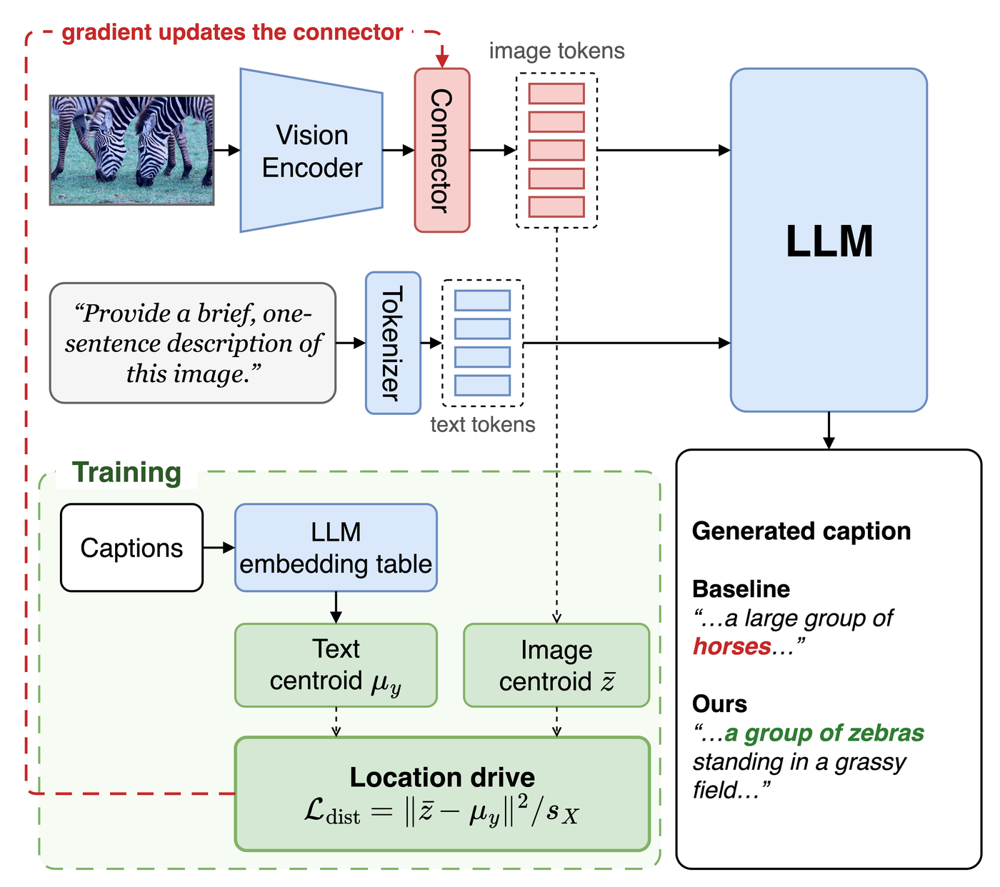

# Closing the Distance: The Modality Gap in MLLM Captioning

> Code and results for the paper *Closing the Distance: The Modality Gap in MLLM Captioning*.
> Hassine El Ghazel · Dr. Federico D'Asaro · Prof. Giuseppe Rizzo

<p align="center">
  
</p>
<p align="center"><em>Closing the modality gap during training: moving the image tokens towards the text helps the model to caption images.</em></p>

---

## Abstract

The modality gap of contrastive encoders such as CLIP, where image and text embeddings occupy separate
regions, also appears in connector-based multimodal large language models: projected image tokens sit
apart from text-token embeddings in the language model's input space, even in fully trained released
models. Prior corrections change several properties of this gap at once and evaluate a combined
effect, so they cannot show which property matters. We describe the alignment between image and text
by four properties (location, scale, shape and orientation) and drive each with a training loss while
holding the others fixed, so every change can be attributed to one property. In image captioning,
only closing the centroid distance improves every measure: captions match their images better and
name more of the objects present while hallucinating fewer. Shrinking the scale hurts every measure,
changing the shape has no clear effect, and changing the orientation helps only slightly; the pattern
holds out of distribution and under a second scoring model. Shifting tokens at inference does not
reproduce the gain, and the training-time loss adds no inference cost.

## Introduction

Multimodal Large Language Models (MLLMs) give a frozen language decoder vision by training a module,
the **connector**, that maps the features of a frozen visual encoder into the decoder's input space.
The design is inexpensive and powers most open-source models, but it concentrates the entire
cross-modal problem in the connector. Such models are usually trained in two stages: the connector is
first aligned alone on image–caption pairs, and is then trained together with the decoder, or with
adapters on it, on instruction data, a step called instruction tuning. In contrastive models such as
CLIP, image and caption embeddings occupy separate regions of their shared space, a separation called
the **modality gap**. In an MLLM, the connector's output enters the decoder directly, so if it lands
outside the distribution the decoder was trained on, the decoder must read inputs unlike those it
learned to interpret. Nothing in instruction tuning keeps the image tokens close to the text: in our
baseline, it moves the image centroid 38% further from the text than after the first stage.

Fusing modalities without first aligning them can lose or misread information; in an MLLM the
connector aligns the image features with the text, and the language model fuses them. We therefore
hypothesise that the modality gap at the input of the language model affects what the model
generates. The gap has first been measured by the Euclidean distance between the image and text
centroids; later corrections change several properties of the image embeddings at once, such as the
position of their centroid and their spread, and report only the combined effect. We study this
question on **image captioning**, where the model must describe what an image contains. We describe
the alignment between the image and text distributions by **four properties**, location, scale, shape
and orientation, and drive each during training while the other three are held fixed. Compared with
the constrained baseline, which differs only in location, **closing the centroid distance** raises
CLIPScore on brief captions from 0.5799 to 0.6325, and on long captions lowers CHAIR<sub>i</sub> from
0.4396 to 0.3698. Shrinking the scale worsens every measure, changing the shape has no clear effect,
and changing the orientation has a small effect.

Because our objective loss acts only during training, the trained model has the same number of
parameters and the same GPU memory as one trained without it, and it takes no longer to generate a
caption. We train every condition for 450 Stage-2 steps, with one pairing of CLIP ViT-L/14 and
LLaMA-2-7B. Our contributions are as follows.

- We study the effect of the modality gap on a small-scale MLLM at the connector level, on the image
  captioning task.
- We describe the alignment between image and text at the input of the language model by four
  non-redundant properties, location, scale, shape and orientation, each adjustable by a
  differentiable loss computed on a single batch.
- We attribute image-captioning quality to each property: location helps most, shrinking the scale
  hurts, lowering the rank (shape) has no clear effect, and orientation has only a small one.

---

## Methodology

We ask whether reducing the modality gap at the language model's input improves image captioning, and
which aspect of the gap is responsible. To isolate one geometric quantity at a time, we train the
connector from a known initialization and track its geometry at every step. We therefore build our own
MLLM rather than fine-tuning an existing one, since isolating each gap property requires controlling
the connector's geometry throughout training, whereas a released checkpoint fixes it and lacks a
comparable reference trained under the same conditions. We compare models trained under the same
pipeline. The **baseline** uses this pipeline with no term acting on the geometry of the image tokens.
The **constrained baseline** adds constraints that keep the geometric properties of the modality gap
fixed during training. We call each trained model a **condition**; each single-property condition then
changes one property and keeps the others fixed, so it differs from the constrained baseline in
exactly one property.

### Architecture

We use a connector-based MLLM. An image is encoded by a frozen CLIP ViT-L/14 vision encoder into 257
token features, the first of which is the `[CLS]` token. A two-layer MLP connector with GELU
activation projects each token into the 4096-dimensional input space of the language model,
LLaMA-2-7B, loaded in 4-bit precision and frozen apart from low-rank adapters (LoRA). Text enters
through the language model's frozen embedding table. The connector is the only trainable component on
the visual path, so every change to the geometry of the image tokens at the input of the language
model comes from it.

<p align="center">
  
</p>
<p align="center"><em>The model architecture: a frozen CLIP ViT-L/14 encoder, a two-layer MLP connector, and a
frozen 4-bit LLaMA-2-7B with LoRA adapters. The image tokens and the text tokens share the
4096-dimensional input space of the language model.</em></p>

### Training pipeline

Training has two stages.

**Stage 1: alignment.** Only the connector $\phi$ is trained, on image–caption pairs. For a batch of
$B$ pairs, let $u_{b,t}$ be the projected token $t$ of image $b$, with $t = 1$ the `[CLS]` token, and
$y_c$ the mean of the embedding-table vectors of the content tokens of caption $c$. With the cosine
similarity $\mathrm{sim}(g, h) = g^\top h / (\lVert g \rVert\,\lVert h \rVert)$ and
$\ell_{bc} = \mathrm{sim}(u_{b,1}, y_c)/\tau$, Stage 1 minimises the symmetric InfoNCE objective

$$\mathcal{L}_{\mathrm{NCE}} = -\frac{1}{2B}\sum_b \left[\log\frac{e^{\ell_{bb}}}{\sum_c e^{\ell_{bc}}} + \log\frac{e^{\ell_{bb}}}{\sum_c e^{\ell_{cb}}}\right]$$

with respect to $\phi$ and the temperature $\tau$, so that matching images and captions are brought
together while the text side stays fixed.

**Stage 2: instruction tuning.** The connector and the LoRA adapters are trained together on
instruction data. Given the projected image tokens $u$, an instruction $q$ and a response
$a_1, \dots, a_K$, the language model is trained to predict each response token:

$$\mathcal{L}_{\mathrm{AR}} = -\sum_{k=1}^{K} \log p_\theta\left(a_k \mid u, q, a_{<k}\right),$$

where $\theta$ are the trainable parameters. This loss gives the connector no direct signal about the
geometry of its output. Stage 2 with $\mathcal{L}_{\mathrm{AR}}$ alone is our baseline; the geometry
objectives below are added to it.

<p align="center">
  
</p>
<p align="center">
  
</p>
<p align="center"><em>The two training stages. Top, Stage 1: contrastive pretraining of the connector with an
InfoNCE loss on image–caption pairs. Bottom, Stage 2: efficient autoregressive tuning of the connector
and the language model (LoRA) on image–instruction–response data.</em></p>

**Relation to standard MLLM training pipelines.** The two-stage setup follows LLaVA, whose first stage
trains only the connector and whose second stage trains the connector and the language model
together. BLIP-2 uses the same split, but its first stage combines three objectives against a
trainable text transformer. Our first stage keeps the contrastive part, using the language model's
frozen embedding table; it uses image–caption pairs from the Bunny-v1.1 dataset. The second stage
keeps LLaVA's instruction tuning: the same autoregressive loss on response tokens and the same
dataset, LLaVA-Instruct-150K. Instead of fine-tuning the whole language model, we train low-rank
adapters on a 4-bit model.

### Measuring the modality gap

We measure the modality gap at the input of the language model, where the projected image tokens and
the caption token embeddings share one 4096-dimensional space. We hypothesise that training the
connector while reducing the gap makes the image tokens easier for the language model to interpret
for image captioning.

We summarise each image $i$ by the mean $x_i$ of its $T = 257$ projected tokens, and each caption by
the mean $y_i$ of the embeddings of its content tokens. For $N$ image–caption pairs, these give the
image cloud $X$ and the text cloud $Y$, with means $\bar x$, $\bar y$ and covariances $\Sigma_X$,
$\Sigma_Y$. We describe the gap by four properties:

| property | measure |
|:---|:---|
| location | centroid distance $G_\mu = \lVert \bar x - \bar y \rVert$, and the normalised gap $\widehat G_\mu = G_\mu / \sqrt{\mathrm{tr}\,\Sigma_X}$ to compare models |
| scale | total variance $s = \mathrm{tr}\,\Sigma_X$ |
| shape | effective rank (participation ratio) $r = (\mathrm{tr}\,\Sigma_X)^2 / \mathrm{tr}(\Sigma_X^2)$ |
| orientation | subspace overlap $O_q = \tfrac{1}{q}\lVert U_X^{(q)\top} U_Y^{(q)} \rVert_F^2$ of the $q = 16$ leading directions (chance ≈ 3.9×10⁻³) |

$G_\mu$ is measured in the units of embedding space, so it cannot be compared across models whose
embeddings have different magnitudes, such as the released models below. The normalised gap
$\widehat G_\mu$ expresses the distance in units of the spread of the image cloud, the square root of
its total variance; since both are distances, their ratio does not change when all embeddings are
rescaled. We use $\widehat G_\mu$ to compare models and $G_\mu$ within our own. The four properties are
not redundant: each can be moved while the other three change far less, as the single-property
isolation below verifies.

**Token pooling.** Each image produces 257 tokens, which must be summarised by one vector to compute
these measures. CLIP's own summary is the `[CLS]` token, which Stage 1 uses. However, the language
model reads all 257 tokens, so we summarise each image by the mean of all its tokens, both for the
measures and for the objectives below.

### Geometry objectives

The four measures only describe the geometry; to change it during training, each must be turned into
a differentiable loss computed on every training batch. Each property receives a term that acts in one
of two ways: as a **drive**, which moves the property towards a new target, or as a **constraint**,
which holds it at its post-Stage-1 value. In these terms, the constrained baseline constrains all four
properties, and each single-property condition drives one property and constrains the other three. We
name each single-property condition by the letter C and the property it drives, followed for scale
and shape by the value that property reaches on the evaluation images: **Cloc**, **Cscale1500**,
**Crank20** and **Corient**. At every step, the losses are computed on a separate batch of $B = 64$
training images with their captions, drawn independently of the instruction batch.

| property | measure | drive | constraint |
|:---|:---|:---|:---|
| location | $G_\mu$ | $\mathcal{L}_{\mathrm{dist}}$, towards $\mu_y$ | $\mathcal{L}_{\mathrm{loc}}$, at $\mu_{x_0}$ |
| scale | $s$ | $\mathcal{L}_{\mathrm{scale}}$, new target | $\mathcal{L}_{\mathrm{scale}}$, at $s_0$ |
| shape | $r$ | $\mathcal{L}_{\mathrm{rank}}$, new target | $\mathcal{L}_{\mathrm{rank}}$, at $r_0$ |
| orientation | $O_q$ | $\mathcal{L}_{\mathrm{NCE}}$ | no contrastive term |

<p align="center">
  
</p>
<p align="center"><em>Geometric interventions on the image cloud. Panel (a) is the constrained baseline, with all
four properties constrained; panels (b)–(e) each drive one property while the other three stay
constrained. Dashed ellipses show the image cloud before the intervention, solid ones after it; the
text cloud Y stays fixed.</em></p>

**Constraints.** A constraint holds a property at its post-Stage-1 value. For location, it holds the
batch centroid $\bar z$ at $\mu_{x_0}$, the image centroid after Stage 1; for scale and shape, it holds
$s$ and $r$ at $s_0 = 4767.3$ and $r_0 = 23.31$:

$$\mathcal{L}_{\mathrm{loc}} := \frac{\lVert \bar z - \mu_{x_0} \rVert^2}{s_X}, \qquad \mathcal{L}_{\mathrm{scale}} := \left(\frac{s}{s_0} - 1\right)^2, \qquad \mathcal{L}_{\mathrm{rank}} := \left(\frac{r}{r_0} - 1\right)^2.$$

Each loss is zero at its target. The location loss is divided by a fixed number, $s_X = 4581.6$, the
total variance of the baseline's image cloud. The targets are measured on the first training batch,
and the constrained baseline stays within 10% of its post-Stage-1 values, 4686.6 and 39.19 on the
evaluation images. Orientation has no constraint loss: it is held only by leaving out
$\mathcal{L}_{\mathrm{NCE}}$.

**Location drive.** The location drive acts on the batch centroid $\bar z$, obtained by averaging
first over the tokens of each image and then over the batch:

$$z_b = \frac{1}{T}\sum_{t=1}^{T} u_{b,t}, \qquad \bar z = \frac{1}{B}\sum_{b=1}^{B} z_b = \frac{1}{BT}\sum_{b=1}^{B}\sum_{t=1}^{T} u_{b,t}.$$

It has the same form as the location constraint, but pulls $\bar z$ towards the text centroid
$\mu_y$, the mean $\bar y$ of the caption representations, held fixed during training:

$$\mathcal{L}_{\mathrm{dist}} := \frac{\lVert \bar z - \mu_y \rVert^2}{s_X}, \qquad \frac{\partial \mathcal{L}_{\mathrm{dist}}}{\partial u_{b,t}} = \frac{2(\bar z - \mu_y)}{s_X}\cdot\frac{1}{BT}.$$

The gradient is the same for every token, whatever $b$ or $t$. All tokens receive the same update, a
translation of the whole cloud. Because this update acts through the connector's parameters, however,
it can also change the covariance: without the scale constraint the cloud shrinks (see below). The
constraints prevent this, and the single-property isolation below checks that the other properties
stay close to their post-Stage-1 values while location is driven.

<p align="center">
  
</p>
<p align="center"><em>The location drive. (a) Tokens are averaged per image, then over the batch. (b) The distance
that L<sub>dist</sub> reduces.</em></p>

**Scale drive.** When the location drive runs without the scale constraint, the image cloud also gets
smaller: its total variance falls from 4581.6 to 1723.0. So a gain from the location drive could come
from this shrinking instead. To test this, the scale drive shrinks the cloud by a similar amount, but
leaves its location where it is. It is the scale loss with its target moved to 1500,
$\mathcal{L}_{\mathrm{scale}} = (s/1500 - 1)^2$. So, we call this condition **Cscale1500**.

**Shape drive.** When the location drive runs without the shape constraint, the image cloud also uses
fewer directions: its effective rank falls from 32 to 21 on the evaluation images. So a gain from the
location drive could come from this drop instead. To test this, the shape drive lowers the rank by a
similar amount, but leaves the location where it is. It is the shape loss with its target moved to 15,
$\mathcal{L}_{\mathrm{rank}} = (r/15 - 1)^2$. On the evaluation images this brings the rank to about
20, close to the 21 of the location drive, so we call this condition **Crank20**. The target is lower
than 20 because it is set on batches of 64 images, where the rank is always lower than on the full set.

**Orientation drive.** The orientation drive brings the main directions of the image cloud closer to
those of the text cloud. It uses the contrastive loss of Stage 1, applied to the pooled vectors $z_b$,
with $\ell_{bc} = \mathrm{sim}(z_b, y_c)/\tau$, where $y_c$ is the pooled caption of image $c$ in the
batch. The cosine similarity divides each vector by its length, so the loss sees only directions.
Through the connector it still moves the other properties, so we keep the location, scale and shape
constraints active. Under these constraints, the subspace overlap is the property that changes most.

**The combined loss.** A location or orientation drive,
$\mathcal{L}_{\mathrm{geo}} = \mathcal{L}_{\mathrm{dist}}$ or $\mathcal{L}_{\mathrm{NCE}}$, enters
through a convex combination, so that it is weighted against the language objective rather than added
to it:

$$\mathcal{L}(\theta) = (1-\lambda)\,\mathcal{L}_{\mathrm{AR}}(\theta) + \lambda\,\mathcal{L}_{\mathrm{geo}}(\theta), \qquad \lambda \in [0, 1].$$

The constraints are not part of this combination: they are added with fixed weights, 10 for location
and 1.0 for scale and shape, because they hold a property in place rather than compete with the
language objective. Scale and shape are driven by moving the target of their own term, which keeps its
weight of 1; these conditions, like the constrained baseline, use $\lambda = 0$.

**The choice of λ.** One could let the model learn $\lambda$ together with its other parameters. To
learn $\lambda$ while keeping it in $[0, 1]$, we parameterise it through an unconstrained scalar
$\psi$ as $\lambda = \sigma(\psi)$, where $\sigma$ is the sigmoid function. The gradient with respect
to $\psi$ is $\partial\mathcal{L}/\partial\psi = (\mathcal{L}_{\mathrm{geo}} - \mathcal{L}_{\mathrm{AR}})\,\lambda(1-\lambda)$.
Since $\lambda(1-\lambda)$ is always positive, the sign of this gradient depends only on which loss is
larger. In our run that drives the location ($\lambda = 0.1$, scale and shape constrained),
$\mathcal{L}_{\mathrm{geo}}$ is smaller than $\mathcal{L}_{\mathrm{AR}}$ in 89% of the training steps,
and at every step after the first fifth of training; at the end of training it averages 0.23 against
1.18. The gradient is therefore negative at almost every step, and gradient descent drives $\lambda$ to
1, dropping the language objective entirely. We instead fix $\lambda$ for each drive by a grid search:
$\lambda = 0.1$ for the location drive, which keeps 90% of the weight on the language objective, and
$\lambda = 0.5$ for the orientation drive.

### The total objective

The components above combine into one total objective. Starting from the Stage-1 connector, Stage 2
runs with the autoregressive objective, a location drive towards the frozen text centroid, and
constraints holding scale and shape:

$$\mathcal{L} = 0.9\,\mathcal{L}_{\mathrm{AR}} + 0.1\,\mathcal{L}_{\mathrm{dist}} + 1.0\,\mathcal{L}_{\mathrm{scale}} + 1.0\,\mathcal{L}_{\mathrm{rank}}.$$

This condition is **Cloc**. Compared with the constrained baseline, it replaces the location constraint
by the drive; compared with the baseline, it adds the drive and the two constraints. Only location is
driven, and this choice is intentional: a contrastive drive added to it would also close the centroid
further, so its benefit could not be separated from the extra location closure. We report this
combination, **Clocorient**, a model that combines the location and orientation drives, for reference.

---

## Experiments

### Setup

**Caption types and datasets.** We evaluate two kinds of captions on MSCOCO `val2017`, both decoded
greedily. A **brief caption** is a one-sentence description, generated with the prompt "Provide a
brief, one-sentence description of this image." and at most 64 new tokens, on all 5,000 images; it is
the closest to the MSCOCO reference captions, although our models often write several sentences within
the 64-token limit. A **long caption** is a detailed, multi-sentence description, generated with the
prompt "Describe the following image in detail." and at most 256 new tokens, on the first 1,300 images;
it matches the detailed-description prompts of LLaVA-Instruct-150K, our instruction data, and gives the
model more room to mention objects that are not in the image. Both caption types are scored with the
same measures; for long captions, METEOR is only indicative, since the MSCOCO references are one
sentence long. For training, Stage 1 uses the first 750,000 image–caption pairs of Bunny-v1.1, and
Stage 2 uses LLaVA-Instruct-150K, whose images come from MSCOCO `train2017`, disjoint from the
evaluation split; the geometry losses use the same images with their MSCOCO captions. The gap
statistics are computed in float64 from the projected embeddings of the 5,000 images, without decoding.

**Metrics.** We measure reference-free alignment with CLIPScore, $2.5\cdot\max(\cos(v,t),0)$. We compute
it with CLIP ViT-B/32 rather than the model's own ViT-L/14, so that the captions are not scored by the
same encoder that produced the image features. As a second scoring model, independent of CLIP, we use
SigLIP, an image–text model trained with a different loss, data and tokenizer, and report its
probability that caption and image match, in percent. We measure reference-based quality with METEOR,
which matches words, stems and synonyms against the references. We measure hallucination with CHAIR:
CHAIR<sub>s</sub> is the fraction of captions that mention at least one absent object and
CHAIR<sub>i</sub> the fraction of mentioned objects that are absent, where an object counts as present
if it is among the 80 COCO categories annotated for the image in `val2017` or is named in one of its
five reference captions.

**Experimental details.** We use the public CLIP ViT-L/14 and LLaMA-2-7B checkpoints. The language
model is loaded in 4-bit NF4 with double quantisation, and its LoRA adapters use r = 8, α = 16 and
dropout 0.05 on `q_proj`, `v_proj` and `o_proj`. All runs were executed on a single RTX 2080 Ti with
11 GB. Stage 2 is capped at 450 optimizer steps, 14,400 samples at an effective batch of 32. This short
training makes it affordable to train every condition, at the cost of the best attainable quality.

- **Stage 1.** One epoch over the Bunny-v1.1 pairs (11,719 steps), with a learning rate of 5×10⁻⁴, a
  cosine schedule with 3% warm-up, and batches of 64 pairs.
- **Stage 2.** The 450 steps given above, with a learning rate of 2×10⁻⁴, the same cosine schedule
  with 3% warm-up, and an effective batch of 32 (4 samples with 8 accumulation steps).

Both stages use AdamW without weight decay, bfloat16 precision and seed 42.

### Where the gap comes from

To see which training stage shapes each property, we train without any geometry term and leave out one
stage at a time: Stage 1 only, Stage 2 only, and both stages, which is the baseline. From a randomly
initialised connector, Stage 1 creates the orientation and sets the scale: the subspace overlap rises
from 0.0042, close to chance (0.0039), to 0.0510, about 13 times chance, and the total variance grows
from 229.1 to 4686.6, the range it keeps afterwards. The centroid distance grows with the scale, from
40.98 to 177.67, while the normalised gap $\widehat G_\mu$ stays close (2.71 to 2.60). Stage 2 then
widens the gap: instruction tuning carries the centroid distance from 177.67 to 245.46, 38% further
from the text ($\widehat G_\mu$ from 2.60 to 3.63), because the instruction objective contains nothing
that keeps the image cloud near the text. Trained alone, Stage 2 also pushes the cloud away
($\widehat G_\mu$ from 2.71 to 5.90).

### Main result

| condition | CLIP ↑ | SigLIP ↑ | MET. ↑ | CH<sub>s</sub> ↓ | CH<sub>i</sub> ↓ | CLIP ↑ | SigLIP ↑ | MET. ↑ | CH<sub>s</sub> ↓ | CH<sub>i</sub> ↓ |
|:---|---:|---:|---:|---:|---:|---:|---:|---:|---:|---:|
| | *brief, n=5000* | | | | | *long, n=1300* | | | | |
| baseline | 0.5433 | 2.31 | 0.1595 | 0.6938 | 0.4811 | 0.5200 | 1.83 | 0.1119 | 0.8269 | 0.4966 |
| constr. baseline | 0.5799 | 2.63 | 0.1525 | 0.6832 | 0.4323 | 0.5703 | 3.02 | 0.1261 | 0.7885 | 0.4396 |
| **Cloc** | **0.6325** | **5.38** | **0.1714** | **0.6278** | **0.3490** | **0.6187** | **4.46** | **0.1305** | **0.7369** | **0.3698** |
| Cscale1500 | 0.5466 | 2.07 | 0.1458 | 0.7298 | 0.4683 | 0.5255 | 1.77 | 0.1151 | 0.8900 | 0.5941 |
| Crank20 | 0.5769 | 2.36 | 0.1513 | 0.7022 | 0.4477 | 0.5673 | 3.33 | 0.1232 | 0.7923 | 0.4540 |
| Corient | 0.5950 | 3.04 | 0.1573 | 0.6910 | 0.4133 | 0.5787 | 3.41 | 0.1242 | 0.7838 | 0.4481 |
| Clocorient ¹ | 0.6421 | 5.72 | 0.1733 | 0.6242 | 0.3338 | 0.6312 | 5.25 | 0.1377 | 0.7638 | 0.3656 |

*Caption quality for every condition. CLIP is CLIPScore, SigLIP is SigLIP's probability that caption
and image match, in percent, MET. is METEOR, CH is CHAIR; arrows mark the better direction. Bold is the
best value above the rule.* ¹ *Clocorient drives two properties and is shown for reference.*

All conditions are trained with the same architecture, data and number of steps. The baseline is our
pipeline with the language objective alone. The constrained baseline adds constraints that hold the
four gap properties at their post-Stage-1 values. The four single-property conditions each drive one
property and hold the other three. Clocorient drives location and orientation together, with weights
0.4 L<sub>AR</sub> + 0.1 L<sub>dist</sub> + 0.5 L<sub>NCE</sub> plus the scale and shape constraints,
and is shown for reference.

Against the baseline, Cloc gains 0.0892 CLIPScore on brief captions: 0.0366 from constraining the
geometry, which stops instruction tuning from pushing the image cloud away from the text, and 0.0526
from closing the location gap. The constrained baseline already hallucinates less than the baseline on
both caption types, and Cloc improves on it in every column. Clocorient scores slightly higher but
moves location and orientation together, so its extra gain cannot be attributed to either.

### Single-property isolation

Each remaining condition drives one property of the constrained baseline and holds the other three:
Cscale1500 shrinks the total variance to about 1500, Crank20 lowers the effective rank to about 20, and
Corient doubles the subspace overlap. The table below reports the geometry each condition reaches, and
the main table what each change does to the captions.

| condition | driven | $G_\mu$ | $\mathrm{tr}\,\Sigma_X$ | $r$ | $O_{16}$ |
|:---|:---|---:|---:|---:|---:|
| constr. baseline | none | 177.86 | 4252.7 | 36.99 | 0.0515 |
| Cloc | location | **30.97** | 4789.6 | 37.32 | 0.0519 |
| Cscale1500 | scale | 177.74 | **1487.6** | 38.67 | 0.0435 |
| Crank20 | shape | 177.81 | 4311.6 | **20.21** | 0.0517 |
| Corient | orientation | 177.61 | 4578.8 | 35.95 | **0.1114** |
| Clocorient | loc. and orient. | **11.72** | 4804.1 | 36.32 | **0.2993** |

*Geometry reached by each condition, n=5000. Bold marks the driven property. Clocorient drives two
properties and is shown for reference.*

**Captions that begin with a degenerate word.** Some captions start with a word unrelated to the image,
"nobody" or "hopefully", which no caption of the constrained baseline does. On brief captions this
happens in at most 0.2% of captions for any condition, so the brief-caption results are not affected.
On long captions it reaches 96.3% for Cscale1500 and 52.6% for Corient, and 0% for the other
conditions. Cloc never produces such a caption at either length, so its gain does not come from these
failures.

- **Location has the largest effect.** Closing the centroid distance improves every measure on both
  caption types: CLIPScore rises by 0.0526 on brief and 0.0484 on long captions, METEOR by 0.0189 and
  0.0044, and both hallucination rates fall. The lower hallucination does not come from naming fewer
  objects: on long captions Cloc names more objects per caption (8.98 against 8.69), and on brief
  captions object recall rises from 0.3875 to 0.4528 while CHAIR<sub>i</sub> falls from 0.4323 to
  0.3490. Inference cost does not change: the drive acts only during training, so the model has the
  same parameters, checkpoint size and peak GPU memory as the constrained baseline, and it is even
  slightly faster, taking 7.2 s per caption on average against 8.4 s on our GPU.
- **Compressing the scale hurts.** Reducing the total variance worsens every measure: CLIPScore falls
  by 0.0333 on brief and 0.0448 on long captions, both CHAIR rates rise and recall falls on both
  caption types. On the 48 long captions without a degenerate first word, CHAIR<sub>i</sub> is still
  worse than the constrained baseline by 0.0827, so the higher per-object hallucination comes from the
  geometry.
- **Shape has no clear effect.** Halving the effective rank changes CLIPScore by only −0.0030 on both
  caption types and METEOR by −0.0012 on brief captions. The only consistent change is a small rise in
  hallucination, CHAIR<sub>i</sub> by 0.015 on brief and 0.014 on long captions, as the model names more
  objects without recovering more of those present.
- **Orientation has a small effect.** Doubling the subspace overlap raises CLIPScore by 0.0151 on brief
  captions, about a third of the location effect, and lowers CHAIR<sub>i</sub> while raising recall
  there. On the 616 long captions without a degenerate first word, it lowers CHAIR<sub>i</sub> by
  0.0243, again about a third of the location effect, and raises recall by 0.0462.

### Robustness

<p align="center">
  
</p>
<p align="center"><em>CLIPScore difference from the constrained baseline, which differs from each condition only in
the driven property, with 95% paired bootstrap intervals, in distribution (COCO) and out of
distribution (NoCaps).</em></p>

To test whether the effect is specific to COCO, we caption 300 images from NoCaps, built on Open Images
and disjoint from the training data. The pattern holds: closing the location gap raises CLIPScore by
0.0668, more than in distribution, compressing the variance still hurts, and the shape drive still has
no clear effect.

**A second scoring model.** CLIPScore scores captions with a CLIP model, and our model's image encoder
is also CLIP, so the score could favour conditions whose image tokens are closer to CLIP's own space.
SigLIP, a different image–text model, ranks the four single-property conditions in the same order on
both caption types, so the ranking does not depend on which model computes the score.

**A second seed.** We retrain the baseline, the constrained baseline and the four single-property
conditions with a second seed (Clocorient, shown only for reference, is not retrained), which changes
the data order and the adapter initialisation but keeps the Stage-1 connector. The location gain
repeats on both measures and stays the largest effect, compressing the scale hurts again, and the
constrained baseline still improves on the baseline, by 0.017 CLIPScore instead of 0.037. Orientation
remains positive but shrinks, from +0.015 to +0.004 CLIPScore, so its effect is small.

| condition | CLIPScore, seed 42 | CLIPScore, seed 1337 | METEOR, seed 42 | METEOR, seed 1337 |
|:---|---:|---:|---:|---:|
| constr. baseline | 0.580 | 0.582 | 0.152 | 0.152 |
| baseline | −0.037 | −0.017 | +0.007 | +0.010 |
| Cloc | +0.053 | +0.061 | +0.019 | +0.025 |
| Corient | +0.015 | +0.004 | +0.005 | +0.004 |
| Crank20 | −0.003 | −0.005 | −0.001 | −0.000 |
| Cscale1500 | −0.033 | −0.043 | −0.007 | −0.008 |

*Brief captions, seeds 42 and 1337. The first row gives the constrained baseline's scores; the other
rows give each condition's difference from the constrained baseline trained with the same seed.*

### Tests of the objective

We test the choices behind the location drive and the alternatives to it. The table gives the variants
of the drive, all on brief captions.

| location drive | $G_\mu$ | $\mathrm{tr}\,\Sigma_X$ | $r$ | CLIP |
|:---|---:|---:|---:|---:|
| none (baseline) | 245.46 | 4581.6 | 38.61 | 0.5433 |
| *no constraint* | | | | |
| `[CLS]`, λ = 0.1 | 210.64 | 4087.0 | 39.46 | 0.5847 |
| `[CLS]`, λ = 0.5 | 181.31 | 3669.5 | 41.13 | 0.5793 |
| pooled, λ = 0.1 | 24.03 | 1723.0 | 45.98 | 0.6481 |
| *scale constrained* | | | | |
| none, location held | 177.81 | 4312.3 | 32.32 | 0.5797 |
| pooled, λ = 0.01 | 80.59 | 4788.0 | 27.45 | 0.6240 |
| pooled, λ = 0.1 † | 29.61 | 4791.9 | 21.30 | 0.6337 |
| *scale and shape constrained* | | | | |
| pooled, λ = 0.1 (Cloc) | 30.97 | 4789.6 | 37.32 | 0.6325 |

*Variants of the location drive, brief captions, n=5000.* † *Trained with a scale weight of 2 instead
of 1.*

- **Pooled vector or `[CLS]` token.** Stage 1 aligns the `[CLS]` token, but the language model reads
  all 257 tokens, so it matters which vector the drive acts on. We apply the drive, without
  constraints, either to `[CLS]` or to the pooled vector. At the same weight λ = 0.1, the drive on
  `[CLS]` closes the centroid distance only to 210.64, against 24.03 on the pooled vector, and a larger
  weight on `[CLS]` lowers CLIPScore. The drive must therefore act on the pooled vector, the one the
  decoder reads.
- **The scale constraint.** A cloud can come closer to the text simply by shrinking, so the location
  drive alone could change scale as well. We run the drive on the pooled vector with and without the
  scale constraint. Without it, the cloud shrinks to a total variance of 1723.0 and CLIPScore reaches
  0.6481, the highest in the study, but location, scale and shape move at once, so the gain cannot be
  attributed. With the scale constraint only location and shape move, and adding the shape constraint
  (Cloc) holds the rank as well, at almost the same CLIPScore (0.6325 against 0.6337).
- **The limit of closing the gap.** If closing the gap causes the gain, a larger closure should give a
  larger gain. With scale constrained, we compare no drive, a weak drive (λ = 0.01) and the standard
  one (λ = 0.1). CLIPScore rises as the distance closes, from 0.5797 to 0.6240 and 0.6337, and most of
  the benefit is reached once the distance is a third of the baseline's (80.59).
- **The weight of the orientation drive.** The orientation drive needs a weight λ, and the result
  should not hinge on it. We train the contrastive drive on `[CLS]`, without constraints, for λ from
  0.1 to 0.9 in steps of 0.2. CLIPScore rises by 0.0557 over the baseline at λ = 0.1 and then varies by
  at most 0.0051, so choosing λ = 0.5 within this range does not change the result.
- **The target of the drive.** The text centroid of LLaMA lies near the origin, so the gain could come
  either from where the image centroid ends up or from the particular text it moves towards. We
  replace the LLaMA text centroid by the centroid of CLIP's text encoder, once near the origin like
  the LLaMA one and once moved to 177.85 from it, the size of the original gap. On long captions the
  first gives the same CLIPScore as Cloc (0.6170 against 0.6187) and the second a lower one (0.5968):
  what matters is where the image centroid ends up.
- **Training, not shifting at inference.** If closing the gap is what helps, one could simply move the
  image tokens of a trained model towards the text centroid at inference. We shift the image tokens of
  the trained baseline by a fraction of the way to the text centroid, without retraining, on 300
  images, and compare with a random shift of the same size. A quarter of the way raises CLIPScore by
  0.035, while the random shift lowers it by 0.028; at half the distance 30% of the captions are empty,
  and at the full distance all of them are. The benefit therefore requires training the connector
  under the objective.

### Comparison with the state of the art

Our models are built to study the modality gap, not to compete with state-of-the-art captioners. To see
how far they are from one, we compare Cloc with LLaVA-1.5-7B, a released model of the same design
trained on about 1.2M samples, and also train Cloc on more instruction data: 48.9k and 80k samples
instead of 14.4k. With more data, Cloc moves towards LLaVA-1.5-7B on CLIPScore, from 0.6187 to 0.7033
against 0.7910, and on CHAIR<sub>i</sub>, from 0.3698 to 0.3133 against 0.1518, but not on
CHAIR<sub>s</sub>, which stays above 0.73 while LLaVA-1.5-7B reaches 0.5069. We did not train the
constrained baseline on the same data, so these gains come from our method trained longer, not from
the location drive alone.

| Model | Training samples | CLIP ↑ | CH<sub>s</sub> ↓ | CH<sub>i</sub> ↓ |
|:---|--:|--:|--:|--:|
| Cloc | 14.4k | 0.6187 | 0.7369 | 0.3698 |
| Cloc | 48.9k | 0.6886 | 0.7869 | 0.3314 |
| Cloc | 80k | 0.7033 | 0.7762 | 0.3133 |
| LLaVA-1.5-7B | 1.22M | 0.7910 | 0.5069 | 0.1518 |

*Long captions as the training data grows: Cloc trained on larger sets, and LLaVA-1.5-7B, a released
model of the same design, on far more data.*

The gap is not specific to our small models: fully trained released models keep it open too. Their
normalised gap $\widehat G_\mu$, where larger means the image tokens sit further from the text, is
3.25 for LLaVA-1.5-7B, 2.94 for LLaVA-1.5-13B and 2.19 for bakLLaVA, while for Cloc it is 0.45.

### Qualitative examples

The table shows the brief captions that every condition generates for four images, with their
CLIPScore.

<p align="center">
  
</p>
<p align="center"><em>Qualitative examples (brief captions, CLIPScore). Red: wrong; green: correct main object.</em></p>

---

## Conclusions

We asked which properties of the alignment between image and text at the input of the language model
affect image captioning in a connector-based MLLM. Driving each of location, scale, shape and
orientation while holding the other three, we find that location is the only single-property
condition that improves every measure: against the constrained baseline, Cloc raises CLIPScore by
0.0526 on brief and 0.0484 on long captions and lowers both hallucination rates, and the gain holds on
NoCaps and with a second seed. Shrinking the scale hurts, the shape has no clear effect, and the
orientation has a small effect. At this scale, our results suggest keeping the image centroid close to
the text centroid while instruction tuning the connector. The objective acts only during training, so
the model keeps the same parameters and GPU memory and takes no longer to generate a caption.

**Limitations.** We evaluate a single task, image captioning. We also work at a small scale: one
pairing of CLIP ViT-L/14 and LLaMA-2-7B, loaded in 4-bit with LoRA adapters and trained for 450 steps,
so our absolute scores remain well below those of released models.

**Future work.** We will extend the study to other tasks, such as visual question answering, and to
larger models, other encoder and decoder pairs and more training data, to test whether location
remains the property that matters and how far the findings generalise.

---

## Trained models and results

- **Trained models.** The connector and LoRA adapters of every model in the paper (both seeds), the
  Stage-1 connector and the constants of the location drive will be released upon acceptance.
- **Results.** [`results/`](results/) holds the generated captions and every score behind the tables
  and figures (captions, CLIPScore, SigLIP, METEOR, CHAIR, geometry), under the paper's names. See
  [`results/README.md`](results/README.md).

## Repository layout

```
configs/      encoders, connector, LLM, both training stages and the evaluation regimes
src/
  encoders/     frozen CLIP image and text towers
  models/       connector, VLM assembly, checkpoint I/O
  training/     Stage 1 and Stage 2 loops and the geometry losses
  diagnostics/  projected-embedding extraction, gap measures, plots
  captioning/   generation and scoring helpers
  data/         COCO, Bunny-v1.1 and LLaVA-Instruct loaders
scripts/      numbered pipeline steps and the Slurm launchers for each condition
  paper_figures/  scripts that produce the paper's figures and the qualitative table
  release/        scripts that build the released weights and results
results/      captions and scores of every model in the paper
docs/img/     figures used in this README
tests/        unit tests
```

## Reproducing

```bash
bash scripts/00_setup_env.sh          # Python 3.10, CUDA 12.1
bash scripts/01_download_data.sh

python scripts/05_train_stage1.py --config configs/training_stage1.yaml
python scripts/06_train_stage2.py --config configs/training_stage2.yaml      # baseline

python scripts/07_extract_projected.py --condition <tag>
python scripts/03_compute_gap.py       --condition <tag>
python scripts/08_run_captioning.py    --condition <tag> --vlm-checkpoint <ckpt>
python scripts/15_clipscore.py         --condition <tag>
python scripts/19_chair.py             --conditions <tag> --baseline C3pinr_dd256
```

Internal tags differ from the paper's names: `C3_stage2` is the baseline, `C3pinr` the constrained
baseline, and `dd256` the long captions. Cloc is trained by `scripts/17_train_c5_distance.py`; the
constrained baseline, Cscale1500, Crank20, Corient and Clocorient by
`scripts/18_train_c6_orientation_pinned.py`. The exact flags for every condition are in
`scripts/submit_tierb_seed.sbatch`, which also runs the second seed (`COND=<condition> SEED=1337`).
`java` is required on `PATH` for METEOR.

---

## Using this work

**Code** in this repository is licensed under the **GNU AGPL-3.0-or-later** (see `LICENSE`).
You may use, study, modify and redistribute it, including for research, provided derivative
works are released under the same licence. If you run a modified version as a network
service, the AGPL requires you to offer its source to users of that service.

**The paper text and its figures** are not covered by that licence; all rights in them are reserved
by the authors. **The captions and scores in `results/`** are provided for non-commercial research
use; see `results/LICENSE-NOTICE.md`.

Vendored third-party files retain their original licences; see `THIRD_PARTY_LICENSES.md`.

If you use this code or results derived from it, please cite it. `CITATION.cff` carries the
machine-readable record, and GitHub's "Cite this repository" button reads it.

Copyright (c) 2026 Hassine El Ghazel.
