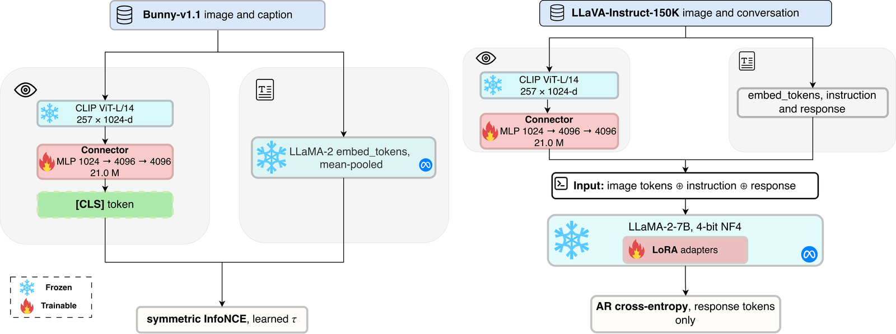
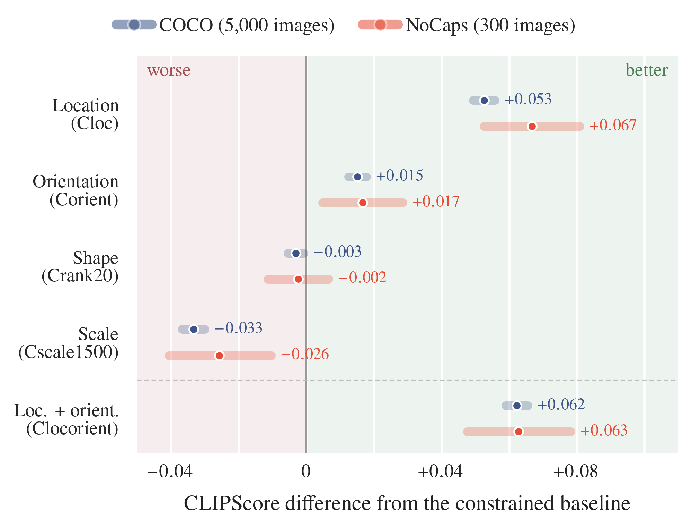
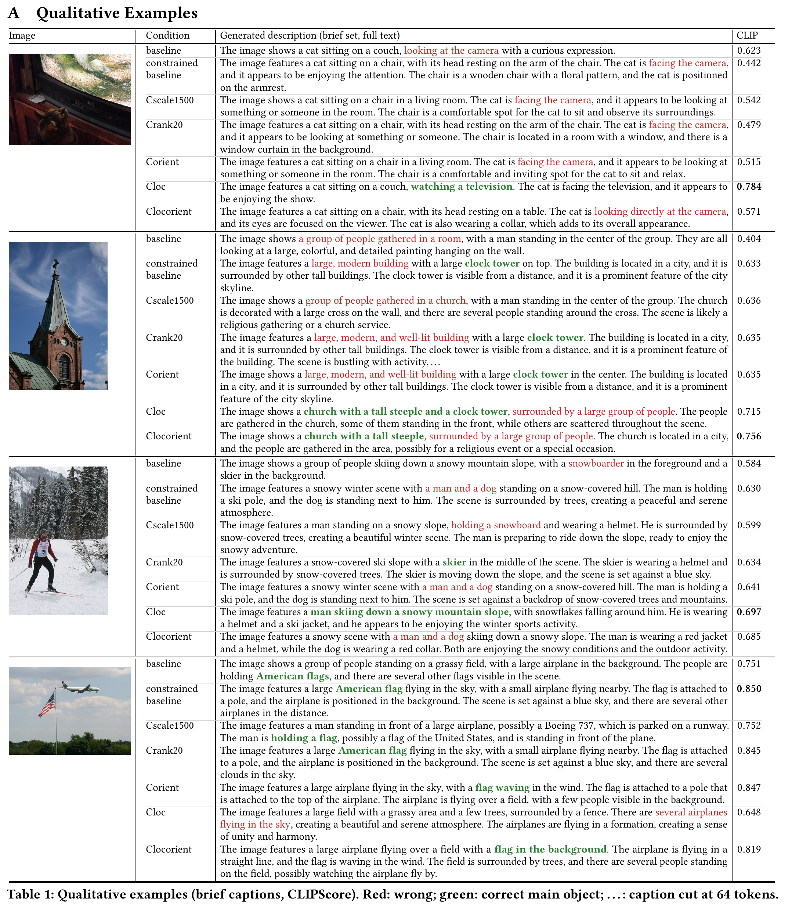

# Modality Gap Properties in Multimodal LLMs for Image Captioning

> Code, trained models and results for the paper *Modality Gap Properties in Multimodal LLMs for Image Captioning*.
> Hassine El Ghazel · Dr. Federico D'Asaro · Prof. Giuseppe Rizzo

---

## Summary

Multimodal large language models (MLLMs) give a frozen language model vision by training a small
module, the **connector**, that maps the features of a frozen visual encoder into the language
model's input space. The image tokens that reach the language model sit away from the text, a
separation known as the **modality gap**, and standard instruction tuning moves them further away.

We describe the alignment between the image and text distributions at the input of the language
model by **four properties**: location (centroid distance), scale (total variance), shape (effective
rank) and orientation (subspace overlap). We drive each property with a training loss while
**holding the other three**, and measure the effect on image captioning. Driving location is the
only single-property intervention that improves every measure; shrinking the scale worsens every
measure, changing the shape has no clear effect, and changing the orientation has a small,
seed-dependent effect. The loss acts only during training, so the trained model has the same
parameters and GPU memory and takes no longer to generate a caption.

---

## Architecture and training

A frozen CLIP ViT-L/14 encoder, a trainable two-layer MLP connector, and a frozen LLaMA-2-7B (4-bit)
with LoRA adapters. Training has two stages: **Stage 1** trains only the connector with a symmetric
InfoNCE loss between the `[CLS]` token and the mean-pooled caption (Bunny-v1.1); **Stage 2**
(instruction tuning) trains the connector and the LoRA adapters with an autoregressive loss on
response tokens (LLaVA-Instruct-150K). The **baseline** is this pipeline with no geometry term.

<p align="center">
  
</p>

<p align="center">
  
</p>

---

## The four properties

Measured on the mean of the 257 projected tokens of each image (image cloud `X`) and the mean of
each caption's token embeddings (text cloud `Y`):

| property | measure |
|:---|:---|
| location | centroid distance $G_\mu = \lVert \bar x - \bar y \rVert$ |
| scale | total variance $s = \mathrm{tr}\,\Sigma_X$ |
| shape | effective rank $r = (\mathrm{tr}\,\Sigma_X)^2 / \mathrm{tr}(\Sigma_X^2)$ |
| orientation | subspace overlap $O_{16}$ of the top-16 principal directions |

Each property can be **driven** to a new target or **constrained** at its post-Stage-1 value. The
**constrained baseline** constrains all four; each **single-property condition** drives one
property and constrains the other three:

| condition | driven property |
|:---|:---|
| Cloc | location, towards the text centroid |
| Cscale1500 | scale, total variance to about 1500 |
| Crank20 | shape, effective rank to about 20 |
| Corient | orientation, contrastive loss on the pooled vectors |
| Clocorient | location and orientation together (reference only) |

<p align="center">
  
</p>

The location drive pulls the batch mean of the pooled image vectors towards the text centroid, so
every token receives the same gradient and the image cloud moves as a whole:

$$\mathcal{L}_{\mathrm{dist}} = \frac{\lVert \bar z - \mu_y \rVert^2}{s_X}, \qquad
\bar z = \frac{1}{BT}\sum_{b=1}^{B}\sum_{t=1}^{T} u_{b,t}$$

<p align="center">
  
</p>

Cloc trains with

$$\mathcal{L} = 0.9\,\mathcal{L}_{\mathrm{AR}} + 0.1\,\mathcal{L}_{\mathrm{dist}} + 1.0\,\mathcal{L}_{\mathrm{scale}} + 1.0\,\mathcal{L}_{\mathrm{rank}}.$$

---

## Results

Brief captions: MSCOCO `val2017`, 5,000 images, at most 64 new tokens. Long captions: first 1,300
images, at most 256 new tokens. CLIPScore uses CLIP ViT-B/32; SigLIP is SigLIP's probability that
caption and image match, in percent.

### Main result

| condition | CLIP ↑ | SigLIP ↑ | METEOR ↑ | CHAIR<sub>s</sub> ↓ | CHAIR<sub>i</sub> ↓ | CLIP ↑ | SigLIP ↑ | METEOR ↑ | CHAIR<sub>s</sub> ↓ | CHAIR<sub>i</sub> ↓ |
|:---|---:|---:|---:|---:|---:|---:|---:|---:|---:|---:|
| | *brief* | *brief* | *brief* | *brief* | *brief* | *long* | *long* | *long* | *long* | *long* |
| baseline | 0.5433 | 2.31 | 0.1595 | 0.6938 | 0.4811 | 0.5200 | 1.83 | 0.1119 | 0.8269 | 0.4966 |
| constrained baseline | 0.5799 | 2.63 | 0.1525 | 0.6832 | 0.4323 | 0.5703 | 3.02 | 0.1261 | 0.7885 | 0.4396 |
| **Cloc** | **0.6325** | **5.38** | **0.1714** | **0.6278** | **0.3490** | **0.6187** | **4.46** | **0.1305** | **0.7369** | **0.3698** |
| Cscale1500 | 0.5466 | 2.07 | 0.1458 | 0.7298 | 0.4683 | 0.5255 | 1.77 | 0.1151 | 0.8900 | 0.5941 |
| Crank20 | 0.5769 | 2.36 | 0.1513 | 0.7022 | 0.4477 | 0.5673 | 3.33 | 0.1232 | 0.7923 | 0.4540 |
| Corient | 0.5950 | 3.04 | 0.1573 | 0.6910 | 0.4133 | 0.5787 | 3.41 | 0.1242 | 0.7838 | 0.4481 |
| Clocorient ¹ | 0.6421 | 5.72 | 0.1733 | 0.6242 | 0.3338 | 0.6312 | 5.25 | 0.1377 | 0.7638 | 0.3656 |

¹ Clocorient drives location and orientation together, so its extra gain cannot be attributed to
either property.

### Geometry reached (n = 5,000; bold = driven property)

| condition | $G_\mu$ | $\mathrm{tr}\,\Sigma_X$ | $r$ | $O_{16}$ |
|:---|---:|---:|---:|---:|
| constrained baseline | 177.86 | 4252.7 | 36.99 | 0.0515 |
| Cloc | **30.97** | 4789.6 | 37.32 | 0.0519 |
| Cscale1500 | 177.74 | **1487.6** | 38.67 | 0.0435 |
| Crank20 | 177.81 | 4311.6 | **20.21** | 0.0517 |
| Corient | 177.61 | 4578.8 | 35.95 | **0.1114** |
| Clocorient | **11.72** | 4804.1 | 36.32 | **0.2993** |

### Robustness

<p align="center">
  
</p>

- **Out of distribution.** On 300 NoCaps images the pattern holds: Cloc +0.0668 CLIPScore over the
  constrained baseline.
- **A second scoring model.** SigLIP ranks the four single-property conditions in the same order as
  CLIPScore on both caption types.
- **A second seed.** Brief captions, difference from the constrained baseline trained with the
  same seed (Clocorient is not retrained):

| condition | CLIPScore (42 / 1337) | METEOR (42 / 1337) |
|:---|:---|:---|
| constrained baseline (absolute) | 0.580 / 0.582 | 0.153 / 0.152 |
| baseline | −0.037 / −0.017 | +0.007 / +0.010 |
| Cloc | +0.053 / +0.061 | +0.019 / +0.025 |
| Corient | +0.015 / +0.004 | +0.005 / +0.004 |
| Crank20 | −0.003 / −0.005 | −0.001 / −0.000 |
| Cscale1500 | −0.033 / −0.043 | −0.007 / −0.008 |

### Tests of the objective (brief captions)

| location drive | $G_\mu$ | $\mathrm{tr}\,\Sigma_X$ | $r$ | CLIP |
|:---|---:|---:|---:|---:|
| none (baseline) | 245.46 | 4581.6 | 38.61 | 0.5433 |
| `[CLS]`, λ = 0.1, no constraint | 210.64 | 4087.0 | 39.46 | 0.5847 |
| `[CLS]`, λ = 0.5, no constraint | 181.31 | 3669.5 | 41.13 | 0.5793 |
| pooled, λ = 0.1, no constraint | 24.03 | 1723.0 | 45.98 | 0.6481 |
| none, location and scale held | 177.81 | 4312.3 | 32.32 | 0.5797 |
| pooled, λ = 0.01, scale constrained | 80.59 | 4788.0 | 27.45 | 0.6240 |
| pooled, λ = 0.1, scale constrained | 29.61 | 4791.9 | 21.30 | 0.6337 |
| pooled, λ = 0.1, scale and shape constrained (Cloc) | 30.97 | 4789.6 | 37.32 | 0.6325 |

Replacing the text centroid with a CLIP text centroid near the origin gives the same result
(0.6170 against 0.6187 on long captions), while the same target at the original distance gives
0.5968. Shifting the image tokens of the trained baseline at inference, without retraining, helps
only for small shifts.

### Comparison with released models

LLaVA-1.5-7B reaches 0.7910 CLIPScore and 0.1518 CHAIR<sub>i</sub> on long captions. Released models
keep the gap open: the normalised gap $\widehat G_\mu$ is 2.19 for bakLLaVA, 2.94 for LLaVA-1.5-13B
and 3.25 for LLaVA-1.5-7B, against 3.63 for our baseline and 0.45 for Cloc.

### Qualitative examples

<p align="center">
  
</p>

---

## Trained models and results

- **Trained models.** The connector and LoRA adapters of every model in the paper (both seeds),
  the Stage-1 connector and the constants of the location drive are on the Hugging Face Hub:
  `HF_LINK` (see the model card for loading instructions and licences).
- **Results.** [`results/`](results/) holds the generated captions and every score behind the
  tables and figures (captions, CLIPScore, SigLIP, METEOR, CHAIR, geometry), under the paper's
  names. See [`results/README.md`](results/README.md).

## Repository layout

```
configs/      encoders, connector, LLM, both training stages and the evaluation regimes
src/
  encoders/     frozen CLIP image and text towers
  models/       connector, VLM assembly, checkpoint I/O
  training/     Stage 1 and Stage 2 loops and the geometry losses
  diagnostics/  projected-embedding extraction, gap measures, plots
  captioning/   generation and scoring helpers
  data/         COCO, Bunny-v1.1 and LLaVA-Instruct loaders
scripts/      numbered pipeline steps and the Slurm launchers for each condition
  paper_figures/  scripts that produce the paper's figures and appendix table
  release/        scripts that build the released weights and results
results/      captions and scores of every model in the paper
docs/img/     figures used in this README
tests/        unit tests
```

## Reproducing

```bash
bash scripts/00_setup_env.sh          # Python 3.10, CUDA 12.1
bash scripts/01_download_data.sh

python scripts/05_train_stage1.py --config configs/training_stage1.yaml
python scripts/06_train_stage2.py --config configs/training_stage2.yaml      # baseline

python scripts/07_extract_projected.py --condition <tag>
python scripts/03_compute_gap.py       --condition <tag>
python scripts/08_run_captioning.py    --condition <tag> --vlm-checkpoint <ckpt>
python scripts/15_clipscore.py         --condition <tag>
python scripts/19_chair.py             --conditions <tag> --baseline C3pinr_dd256
```

Internal tags differ from the paper's names: `C3_stage2` is the baseline, `C3pinr` the constrained
baseline, and `dd256` the long captions. Cloc is trained by `scripts/17_train_c5_distance.py`; the
constrained baseline, Cscale1500, Crank20, Corient and Clocorient by
`scripts/18_train_c6_orientation_pinned.py`. The exact flags for every condition are in
`scripts/submit_tierb_seed.sbatch`, which also runs the second seed (`COND=<condition> SEED=1337`).
`java` is required on `PATH` for METEOR.

---

## Using this work

**Code** in this repository is licensed under the **GNU AGPL-3.0-or-later** (see `LICENSE`).
You may use, study, modify and redistribute it, including for research, provided derivative
works are released under the same licence. If you run a modified version as a network
service, the AGPL requires you to offer its source to users of that service.

**The paper text and its figures** are not covered by that licence; all rights in them are reserved
by the authors. **The captions and scores in `results/` and the released model weights** are
provided for non-commercial research use; see `results/LICENSE-NOTICE.md`.

Vendored third-party files retain their original licences; see `THIRD_PARTY_LICENSES.md`.

If you use this code or results derived from it, please cite it. `CITATION.cff` carries the
machine-readable record, and GitHub's "Cite this repository" button reads it.

Copyright (c) 2026 Hassine El Ghazel.
