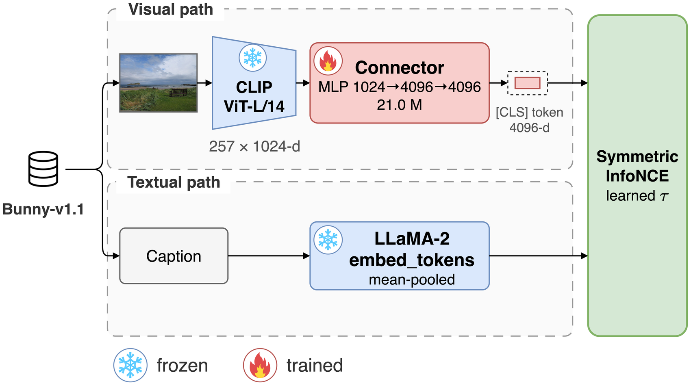
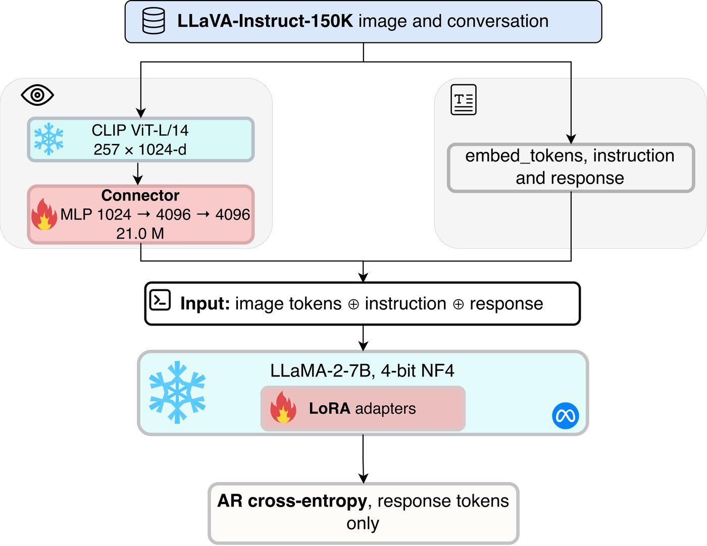
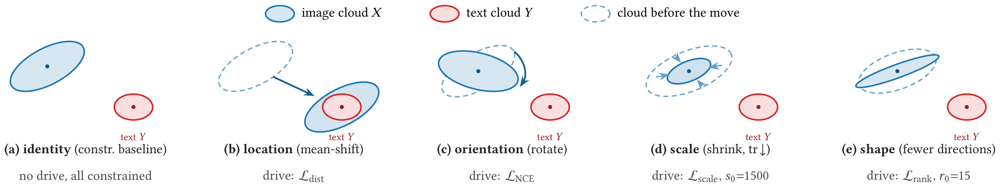
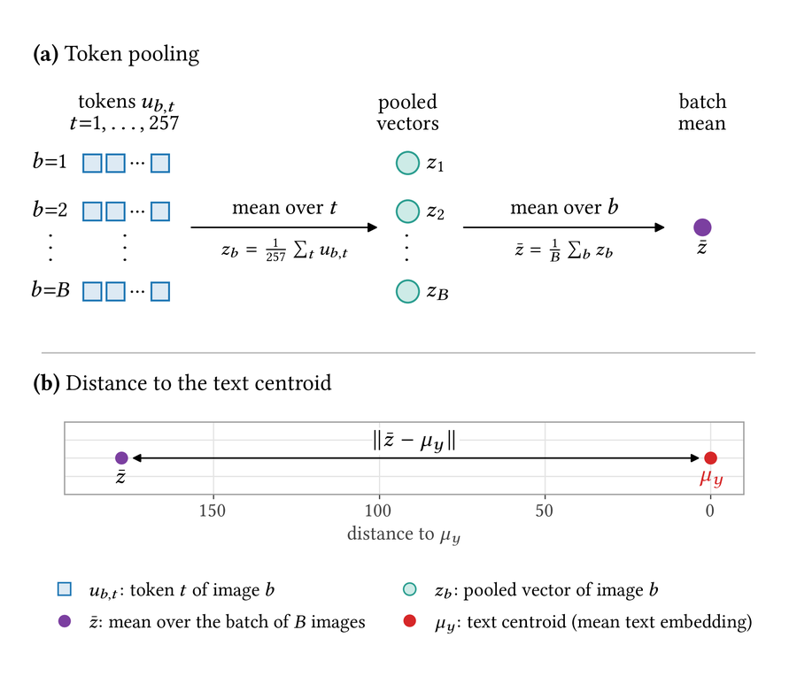

# Closing the Distance: The Modality Gap in MLLM Captioning

> Code and results for the paper *Closing the Distance: The Modality Gap in MLLM Captioning*.
> Hassine El Ghazel · Dr. Federico D'Asaro · Prof. Giuseppe Rizzo

---

## Overview

Multimodal Large Language Models (MLLMs) give a frozen language decoder vision by training a module,
the **connector**, that maps the features of a frozen visual encoder into the decoder's input space.
Such models are usually trained in two stages: the connector is first aligned alone on
image–caption pairs, and is then trained together with the decoder, or with adapters on it, on
instruction data (instruction tuning). In contrastive models such as CLIP, image and caption
embeddings occupy separate regions of their shared space, a separation called the **modality gap**.
Nothing in instruction tuning keeps the image tokens close to the text: in our baseline, it moves the
image centroid 38% further from the text than after the first stage.

We hypothesise that the modality gap at the input of the language model affects what the model
generates, and study this question on **image captioning**. We describe the alignment between the
image and text distributions by **four properties**, location, scale, shape and orientation, and
drive each during training while the other three are held. Against a constrained baseline, in which
all four properties are held, **driving location, that is, closing the centroid distance, is the only
single-property intervention that improves every measure**. Compared with the baseline, it raises
CLIPScore on brief captions from 0.5433 to 0.6325, and on long captions lowers CHAIR<sub>i</sub> from
0.4966 to 0.3698. Shrinking the scale worsens every measure, changing the shape has no clear effect,
and changing the orientation has a small, seed-dependent effect.

Because the objective acts only during training, the trained model has the same number of parameters
and the same GPU memory as one trained without it, and it takes no longer to generate a caption.

**Contributions**

- We study the effect of the modality gap on a small-scale MLLM at the connector level, on the image
  captioning task.
- We describe the alignment between image and text at the input of the language model by four
  non-redundant properties, location, scale, shape and orientation, each adjustable by a
  differentiable loss computed on a single batch.
- We attribute image-captioning quality to each property: location helps most, shrinking the scale
  hurts, lowering the rank (shape) has no clear effect, and orientation has only a small one.

---

## Model and training

A frozen CLIP ViT-L/14 encoder (257 tokens of 1024 dimensions, the first being `[CLS]`), a trainable
two-layer MLP connector with GELU (1024 → 4096 → 4096, 21.0 M parameters), and LLaMA-2-7B loaded in
4-bit NF4 and frozen apart from LoRA adapters (r = 8, α = 16, dropout 0.05 on `q_proj`, `v_proj`,
`o_proj`). Text enters through the language model's frozen embedding table.

<p align="center">
  
</p>

- **Stage 1: alignment.** Only the connector is trained, with a symmetric InfoNCE loss between the
  projected `[CLS]` token and the mean of the caption's embedding-table vectors, on the first 750,000
  image–caption pairs of Bunny-v1.1 (one epoch, 11,719 steps, learning rate 5×10⁻⁴, batches of 64).
- **Stage 2: instruction tuning.** The connector and the LoRA adapters are trained together with an
  autoregressive loss on response tokens, on LLaVA-Instruct-150K (450 steps, about 14,400 samples,
  effective batch 32, learning rate 2×10⁻⁴). Stage 2 with this loss alone is the **baseline**.

<p align="center">
  
  
</p>

All runs use AdamW without weight decay, bfloat16 precision, a cosine schedule with 3% warm-up, and a
single RTX 2080 Ti with 11 GB.

---

## Measuring the modality gap

Each image is summarised by the mean `x_i` of its 257 projected tokens, and each caption by the mean
`y_i` of its content-token embeddings; over N image–caption pairs these give the image cloud `X` and
the text cloud `Y`. We describe the alignment between the two clouds by four properties:

| property | measure |
|:---|:---|
| location | centroid distance $G_\mu = \lVert \bar x - \bar y \rVert$, and the normalised gap $\widehat G_\mu = G_\mu / \sqrt{\mathrm{tr}\,\Sigma_X}$ to compare models |
| scale | total variance $s = \mathrm{tr}\,\Sigma_X$ |
| shape | effective rank (participation ratio) $r = (\mathrm{tr}\,\Sigma_X)^2 / \mathrm{tr}(\Sigma_X^2)$ |
| orientation | subspace overlap $O_q = \tfrac{1}{q}\lVert U_X^{(q)\top} U_Y^{(q)} \rVert_F^2$ of the $q = 16$ leading directions (chance ≈ 3.9×10⁻³) |

## Geometry objectives

Each property receives a term that acts either as a **drive**, which moves the property towards a new
target, or as a **constraint**, which holds it at its post-Stage-1 value. We call each trained model a
**condition**. The **constrained baseline** constrains all four properties; each **single-property
condition** drives one property and constrains the other three. The losses are computed at every step
on a separate batch of B = 64 training images with their captions.

| property | measure | drive | constraint |
|:---|:---|:---|:---|
| location | $G_\mu$ | $\mathcal{L}_{\mathrm{dist}}$, towards the text centroid $\mu_y$ | $\mathcal{L}_{\mathrm{loc}}$, at the post-Stage-1 centroid |
| scale | $s$ | $\mathcal{L}_{\mathrm{scale}}$, new target | $\mathcal{L}_{\mathrm{scale}}$, at $s_0 = 4767.3$ |
| shape | $r$ | $\mathcal{L}_{\mathrm{rank}}$, new target | $\mathcal{L}_{\mathrm{rank}}$, at $r_0 = 23.31$ |
| orientation | $O_q$ | $\mathcal{L}_{\mathrm{NCE}}$ on the pooled vectors | no contrastive term |

<p align="center">
  
</p>

The conditions are named by the letter C, the property driven and, for scale and shape, the value the
property reaches on the evaluation images: **Cloc**, **Cscale1500**, **Crank20** and **Corient**.

- **Location drive.** A quadratic pull of the batch centroid $\bar z$ towards the frozen text centroid
  $\mu_y$, normalised by $s_X = 4581.6$, the total variance of the baseline's image cloud:
  $\mathcal{L}_{\mathrm{dist}} = \lVert \bar z - \mu_y \rVert^2 / s_X$. Every token receives the same
  gradient, so the update is a translation of the whole cloud.
- **Scale drive.** The scale loss with its target moved to 1500, to test whether shrinking the cloud,
  which the location drive does when scale is free, helps on its own (**Cscale1500**).
- **Shape drive.** The shape loss with its target moved to 15 on batches of 64 images, which brings the
  rank to about 20 on the full set, close to the 21 the location drive reaches when shape is free
  (**Crank20**).
- **Orientation drive.** The contrastive loss applied to the pooled vectors, with location, scale and
  shape constrained (**Corient**).

<p align="center">
  
</p>

A location or orientation drive enters through a convex combination
$\mathcal{L} = (1-\lambda)\,\mathcal{L}_{\mathrm{AR}} + \lambda\,\mathcal{L}_{\mathrm{geo}}$, with
λ = 0.1 for location and λ = 0.5 for orientation; the constraints are added with fixed weights, 10 for
location and 1 for scale and shape. Our method, **Cloc**, is

$$\mathcal{L} = 0.9\,\mathcal{L}_{\mathrm{AR}} + 0.1\,\mathcal{L}_{\mathrm{dist}} + 1.0\,\mathcal{L}_{\mathrm{scale}} + 1.0\,\mathcal{L}_{\mathrm{rank}}.$$

**Clocorient**, shown for reference, drives location and orientation together with weights
0.4 L<sub>AR</sub> + 0.1 L<sub>dist</sub> + 0.5 L<sub>NCE</sub>.

---

## Results

**Brief captions:** "Provide a brief, one-sentence description of this image.", at most 64 new tokens,
all 5,000 images of MSCOCO `val2017`. **Long captions:** "Describe the following image in detail.",
at most 256 new tokens, the first 1,300 images. CLIPScore is computed with CLIP ViT-B/32; SigLIP is
SigLIP's probability that caption and image match, in percent; METEOR is only indicative for long
captions; CHAIR is computed against the 80 COCO object categories.

### Where the gap comes from

From a randomly initialised connector, Stage 1 creates the orientation and sets the scale: the
subspace overlap rises from 0.0042, close to chance (0.0039), to 0.0510, and the total variance grows
from 229.1 to 4686.6. Stage 2 then widens the gap: instruction tuning carries the centroid distance
from 177.67 to 245.46, 38% further from the text ($\widehat G_\mu$ from 2.60 to 3.63).

### Main result

| condition | CLIP ↑ | SigLIP ↑ | MET. ↑ | CH<sub>s</sub> ↓ | CH<sub>i</sub> ↓ | CLIP ↑ | SigLIP ↑ | MET. ↑ | CH<sub>s</sub> ↓ | CH<sub>i</sub> ↓ |
|:---|---:|---:|---:|---:|---:|---:|---:|---:|---:|---:|
| | *brief* | *brief* | *brief* | *brief* | *brief* | *long* | *long* | *long* | *long* | *long* |
| baseline | 0.5433 | 2.31 | 0.1595 | 0.6938 | 0.4811 | 0.5200 | 1.83 | 0.1119 | 0.8269 | 0.4966 |
| constr. baseline | 0.5799 | 2.63 | 0.1525 | 0.6832 | 0.4323 | 0.5703 | 3.02 | 0.1261 | 0.7885 | 0.4396 |
| **Cloc** | **0.6325** | **5.38** | **0.1714** | **0.6278** | **0.3490** | **0.6187** | **4.46** | **0.1305** | **0.7369** | **0.3698** |
| Cscale1500 | 0.5466 | 2.07 | 0.1458 | 0.7298 | 0.4683 | 0.5255 | 1.77 | 0.1151 | 0.8900 | 0.5941 |
| Crank20 | 0.5769 | 2.36 | 0.1513 | 0.7022 | 0.4477 | 0.5673 | 3.33 | 0.1232 | 0.7923 | 0.4540 |
| Corient | 0.5950 | 3.04 | 0.1573 | 0.6910 | 0.4133 | 0.5787 | 3.41 | 0.1242 | 0.7838 | 0.4481 |
| Clocorient ¹ | 0.6421 | 5.72 | 0.1733 | 0.6242 | 0.3338 | 0.6312 | 5.25 | 0.1377 | 0.7638 | 0.3656 |

Bold is the best value among the single-property conditions and the two baselines.
¹ Clocorient drives two properties and is shown for reference.

Against the baseline, Cloc gains 0.0892 CLIPScore on brief captions: 0.0366 from constraining the
geometry, which stops instruction tuning from pushing the image cloud away from the text, and 0.0526
from closing the location gap.

### Single-property isolation

Geometry reached by each condition (n = 5,000; bold marks the driven property):

| condition | driven | $G_\mu$ | $\mathrm{tr}\,\Sigma_X$ | $r$ | $O_{16}$ |
|:---|:---|---:|---:|---:|---:|
| constr. baseline | none | 177.86 | 4252.7 | 36.99 | 0.0515 |
| Cloc | location | **30.97** | 4789.6 | 37.32 | 0.0519 |
| Cscale1500 | scale | 177.74 | **1487.6** | 38.67 | 0.0435 |
| Crank20 | shape | 177.81 | 4311.6 | **20.21** | 0.0517 |
| Corient | orientation | 177.61 | 4578.8 | 35.95 | **0.1114** |
| Clocorient | loc. and orient. | **11.72** | 4804.1 | 36.32 | **0.2993** |

- **Location has the largest effect.** Closing the centroid distance improves every measure on both
  caption types: CLIPScore rises by 0.0526 on brief and 0.0484 on long captions, METEOR by 0.0189 and
  0.0044, and both hallucination rates fall. The lower hallucination does not come from naming fewer
  objects: on long captions Cloc names more objects per caption (8.98 against 8.69), and on brief
  captions object recall rises from 0.3875 to 0.4528 while CHAIR<sub>i</sub> falls from 0.4323 to
  0.3490. Inference cost does not change: Cloc has the same parameters, checkpoint size and peak GPU
  memory as the constrained baseline, and takes 7.2 s per caption on average against 8.4 s.
- **Compressing the scale hurts.** Reducing the total variance lowers every measure: CLIPScore falls
  by 0.0333 on brief and 0.0448 on long captions, both CHAIR rates rise and recall falls.
- **Shape has no clear effect.** Halving the effective rank changes CLIPScore by only −0.0030 on both
  caption types; the only consistent change is a small rise in hallucination.
- **Orientation has a small effect.** Doubling the subspace overlap raises CLIPScore by 0.0151 on
  brief captions, about a third of the location effect.

### Robustness

<p align="center">
  
</p>

- **Out of distribution.** On 300 NoCaps images, built on Open Images and disjoint from the training
  data, closing the location gap raises CLIPScore by 0.0668, more than in distribution.
- **A second scoring model.** SigLIP ranks the four single-property conditions in the same order as
  CLIPScore on both caption types.
- **A second seed.** Brief captions; the first row gives the constrained baseline's scores, the other
  rows each condition's difference from the constrained baseline trained with the same seed.

| condition | CLIPScore, seed 42 | CLIPScore, seed 1337 | METEOR, seed 42 | METEOR, seed 1337 |
|:---|---:|---:|---:|---:|
| constr. baseline | 0.580 | 0.582 | 0.153 | 0.152 |
| baseline | −0.037 | −0.017 | +0.007 | +0.010 |
| Cloc | +0.053 | +0.061 | +0.019 | +0.025 |
| Corient | +0.015 | +0.004 | +0.005 | +0.004 |
| Crank20 | −0.003 | −0.005 | −0.001 | −0.000 |
| Cscale1500 | −0.033 | −0.043 | −0.007 | −0.008 |

### Tests of the objective

Variants of the location drive, brief captions, n = 5,000:

| location drive | $G_\mu$ | $\mathrm{tr}\,\Sigma_X$ | $r$ | CLIP |
|:---|---:|---:|---:|---:|
| none (baseline) | 245.46 | 4581.6 | 38.61 | 0.5433 |
| *no constraint* | | | | |
| `[CLS]`, λ = 0.1 | 210.64 | 4087.0 | 39.46 | 0.5847 |
| `[CLS]`, λ = 0.5 | 181.31 | 3669.5 | 41.13 | 0.5793 |
| pooled, λ = 0.1 | 24.03 | 1723.0 | 45.98 | 0.6481 |
| *scale constrained* | | | | |
| none, location held | 177.81 | 4312.3 | 32.32 | 0.5797 |
| pooled, λ = 0.01 | 80.59 | 4788.0 | 27.45 | 0.6240 |
| pooled, λ = 0.1 | 29.61 | 4791.9 | 21.30 | 0.6337 |
| *scale and shape constrained* | | | | |
| pooled, λ = 0.1 (Cloc) | 30.97 | 4789.6 | 37.32 | 0.6325 |

- **Pooled vector or `[CLS]` token.** The drive must act on the pooled vector, the one the decoder
  reads: on `[CLS]` it closes the centroid distance only to 210.64.
- **The scale constraint.** Without it, the cloud shrinks to 1723.0 and CLIPScore reaches 0.6481, but
  location, scale and shape move at once, so the gain cannot be attributed.
- **The dose.** CLIPScore rises as the distance closes, and most of the benefit is reached once the
  distance is a third of the baseline's.
- **The weight of the orientation drive.** Over λ ∈ {0.1, 0.3, 0.5, 0.7, 0.9}, CLIPScore varies by at
  most 0.0051 after λ = 0.1, so λ = 0.5 does not change the result.
- **The target of the drive.** A CLIP text centroid near the origin gives the same result (0.6170
  against 0.6187 on long captions), the same target at the original distance gives 0.5968: what
  matters is where the image centroid ends up.
- **Training, not shifting at inference.** Shifting the image tokens of the trained baseline towards
  the text centroid helps only for small shifts (+0.035 at a quarter of the way, against −0.028 for a
  random shift of the same size); at the full distance all captions are empty.

### Comparison with the state of the art

Our models are built to study the modality gap, not to compete with state-of-the-art captioners.
To see how far they are from one, we compare Cloc with LLaVA-1.5-7B, a released model of the same
design trained on about 1.2 M samples, and also train Cloc on more instruction data: 48.9k and 80k
samples instead of 14.4k. With more data, Cloc moves towards LLaVA-1.5-7B on CLIPScore, from 0.6187
to 0.7033 against 0.7910, and on CHAIR<sub>i</sub>, from 0.3698 to 0.3133 against 0.1518, but not on
CHAIR<sub>s</sub>, which stays above 0.73 while LLaVA-1.5-7B reaches 0.5069. We did not train the
constrained baseline on the same data, so these gains come from our method trained longer, not from
the location drive alone.

Long captions (n = 1300): Cloc trained on more instruction data, and LLaVA-1.5-7B.

| Model | Training samples | CLIPScore ↑ | CHAIR<sub>s</sub> ↓ | CHAIR<sub>i</sub> ↓ |
|---|--:|--:|--:|--:|
| Cloc | 14.4k | 0.6187 | 0.7369 | 0.3698 |
| Cloc | 48.9k | 0.6886 | 0.7869 | 0.3314 |
| Cloc | 80k | 0.7033 | 0.7762 | 0.3133 |
| LLaVA-1.5-7B | 1.22M | 0.7910 | 0.5069 | 0.1518 |

Released models also keep the gap open: the normalised gap $\widehat G_\mu$ is 2.19 for bakLLaVA,
2.94 for LLaVA-1.5-13B and 3.25 for LLaVA-1.5-7B, against 0.45 for Cloc.

### Qualitative examples

Brief captions of four images by every condition; red marks a wrong object, green a correct main
object. Cloc names the main object correctly in three of them and gets the fourth wrong.

<p align="center">
  
</p>

### Limitations and future work

We evaluate a single task, image captioning, at a small scale: one pairing of CLIP ViT-L/14 and
LLaMA-2-7B, loaded in 4-bit with LoRA adapters and trained for 450 steps on about 14,400 instruction
samples. Future work extends the study to other tasks, such as visual question answering, and to
larger models, other encoder and decoder pairs and more training data.

---

## Trained models and results

- **Trained models.** The connector and LoRA adapters of every model in the paper (both seeds), the
  Stage-1 connector and the constants of the location drive will be released upon acceptance.
- **Results.** [`results/`](results/) holds the generated captions and every score behind the tables
  and figures (captions, CLIPScore, SigLIP, METEOR, CHAIR, geometry), under the paper's names. See
  [`results/README.md`](results/README.md).

## Repository layout

```
configs/      encoders, connector, LLM, both training stages and the evaluation regimes
src/
  encoders/     frozen CLIP image and text towers
  models/       connector, VLM assembly, checkpoint I/O
  training/     Stage 1 and Stage 2 loops and the geometry losses
  diagnostics/  projected-embedding extraction, gap measures, plots
  captioning/   generation and scoring helpers
  data/         COCO, Bunny-v1.1 and LLaVA-Instruct loaders
scripts/      numbered pipeline steps and the Slurm launchers for each condition
  paper_figures/  scripts that produce the paper's figures and appendix table
  release/        scripts that build the released weights and results
results/      captions and scores of every model in the paper
docs/img/     figures used in this README
tests/        unit tests
```

## Reproducing

```bash
bash scripts/00_setup_env.sh          # Python 3.10, CUDA 12.1
bash scripts/01_download_data.sh

python scripts/05_train_stage1.py --config configs/training_stage1.yaml
python scripts/06_train_stage2.py --config configs/training_stage2.yaml      # baseline

python scripts/07_extract_projected.py --condition <tag>
python scripts/03_compute_gap.py       --condition <tag>
python scripts/08_run_captioning.py    --condition <tag> --vlm-checkpoint <ckpt>
python scripts/15_clipscore.py         --condition <tag>
python scripts/19_chair.py             --conditions <tag> --baseline C3pinr_dd256
```

Internal tags differ from the paper's names: `C3_stage2` is the baseline, `C3pinr` the constrained
baseline, and `dd256` the long captions. Cloc is trained by `scripts/17_train_c5_distance.py`; the
constrained baseline, Cscale1500, Crank20, Corient and Clocorient by
`scripts/18_train_c6_orientation_pinned.py`. The exact flags for every condition are in
`scripts/submit_tierb_seed.sbatch`, which also runs the second seed (`COND=<condition> SEED=1337`).
`java` is required on `PATH` for METEOR.

---

## Using this work

**Code** in this repository is licensed under the **GNU AGPL-3.0-or-later** (see `LICENSE`).
You may use, study, modify and redistribute it, including for research, provided derivative
works are released under the same licence. If you run a modified version as a network
service, the AGPL requires you to offer its source to users of that service.

**The paper text and its figures** are not covered by that licence; all rights in them are reserved
by the authors. **The captions and scores in `results/`** are provided for non-commercial research
use; see `results/LICENSE-NOTICE.md`.

Vendored third-party files retain their original licences; see `THIRD_PARTY_LICENSES.md`.

If you use this code or results derived from it, please cite it. `CITATION.cff` carries the
machine-readable record, and GitHub's "Cite this repository" button reads it.

Copyright (c) 2026 Hassine El Ghazel.
